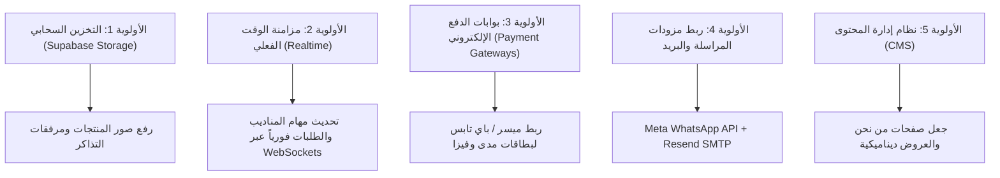

# تقرير حالة الربط بين الواجهة الأمامية والخلفية (Backend Integration Status Report)
**المشروع:** أطياب الزهور للتجارة (Atyab Al Zohour B2B & Retail Platform)  
**تاريخ التوثيق:** 14 نوفمبر 2026  
**المطور المسؤول:** م. حافظ رحيم (+201007419344)  
**بيئة العمل:** React 19 + TanStack Start + Supabase PostgreSQL + Vite 8  

---

## 📌 ملخص تنفيذي (Executive Summary)

تم إنجاز شوط كبير في ربط الواجهات الأمامية بالخلفية السحابية (Supabase) عبر نماذج المصادقة الصارمة، سلة وعمليات الطلب، لوحة تحكم المناديب، لوحة تحكم العميل، ولوحة إدارة المتجر وسجلات الأمان.  
يوثق هذا التقرير **ما تم ربطه بنجاح بنسبة 100%**، **ما يعمل بنظام هجين (Hybrid)**، و**الأجزاء المتبقية التي لم يتم ربطها بعد بالكامل مع الـ Backend والخدمات الخارجية**.

```
[==================== 75% مكتمل ومربوط ====================] [== 25% بحاجة استكمال ==]
```

---

## 1. 🟢 الأقسام المربوطة بالكامل مع الـ Backend (Fully Integrated)

| القسم / الميزة | المسار (Route) | الجداول / الإجراءات في Backend (Supabase) | حالة الربط |
| :--- | :--- | :--- | :--- |
| **المصادقة والأمان** | `/login`, `/register` | `auth.users`, `profiles`, `clients`, `security_logs` | ✅ مربوط بالكامل (حسابات حقيقية، منع القوة الغاشمة، إغلاق الجلسات) |
| **سلة الشراء وإنشاء الطلب** | `/quote` | `orders`, `delivery_tasks`, RPC `reserve_flower_stock`, Edge Function | ✅ مربوط مع خصم المخزون وإنشاء مهام التوصيل |
| **كتالوج المنتجات والأسعار** | `/products`, `/admin/products` | `products`, `pricing_tiers`, `perishable_batches` | ✅ قراءة وتحديث سحابي للمنتجات ومستويات الأسعار وجرد الصلاحية |
| **لوحة إدارة الطلبات** | `/admin/orders` | `orders`, `profiles` | ✅ جلب حقيقي وتحديث حالات الطلب المباشرة |
| **لوحة العملاء وإدارة المنشآت** | `/admin/clients` | `clients`, `profiles`, `orders` | ✅ CRUD وإحصائيات المبيعات لكل عميل |
| **إدارة أسطول المناديب** | `/admin/couriers` | `couriers`, `delivery_tasks`, `courier_telemetry` | ✅ ربط المهام ومؤشرات الأداء |
| **سجل الرقابة والأمان** | `/admin/security` | `security_logs`, `user_sessions`, `profiles` | ✅ تدقيق فوري، إنهاء الجلسات النشطة، تتبع الـ IP والأنشطة |
| **إعدادات المتجر العامة** | `/admin/settings` | `store_settings`, RPC `save_store_setting` | ✅ حفظ الإعدادات، الضرائب، وسياسات التوريد |
| **نموذج التواصل والاستفسارات** | `/contact` | `contact_inquiries`, `security_logs` | ✅ تسجيل الاستفسارات مباشرة في قاعدة البيانات |
| **لوحة العميل (البيانات والطلبات)**| `/dashboard`, `/dashboard/orders` | `profiles`, `orders`, `tickets` | ✅ مزامنة حقيقية حسب المستخدم وإلغاء الطلبات |
| **الدعم الفني للعملاء** | `/dashboard/support` | `tickets`, `security_logs` | ✅ إنشاء التذاكر وإرسال الردود وتحديث السجل |
| **مهام المناديب وإثبات التسليم**| `/courier/tasks` | `delivery_tasks`, `courier_telemetry` | ✅ تحديث الحالات وتوثيق المستلم ودرجات حرارة التبريد |

---

## 2. 🟡 الأقسام المربوطة جزئياً / الهجينة (Partially Integrated / Hybrid)

هذه الأقسام تحتوي على ربط برمجى وتخزين في Supabase، لكنها تفتقر للاتصال مع **واجهات برمجة خارجية (Third-party APIs)**:

### 1. بوابة رسائل الواتساب (`/admin/whatsapp`)
* **الوضع الحالي:**
  - يتم تسجيل الرسائل الصادرة والواردة وتحديث حالتها بنجاح في جدول `whatsapp_logs`.
  - واجهة إعدادات الـ Webhook ورموز الـ QR جاهزة ومحفوظة.
* **ما لم يُربط بعد:**
  - الربط مع مزود واتساب خارجي رسمي (مثل: Meta WhatsApp Cloud API أو UltraMsg / Twilio). إرسال الرسائل الحقيقية لهواتف العملاء الفعليين يتطلب تشغيل Edge Function مخصصة لتمرير رسائل الـ API فورياً.

### 2. خادم البريد الإلكتروني SMTP (`/admin/smtp`)
* **الوضع الحالي:**
  - يتم حفظ بيانات خادم البريد (Host, Port, User, Password, Encryption) وقوالب الإشعارات في جدول `store_settings`.
* **ما لم يُربط بعد:**
  - خدمة إرسال بريد إلكتروني فعلية (Nodemailer Service أو Resend API أو SendGrid) تعمل في السيرفر لتوجيه الإيميلات الحقيقية عند تأكيد الطلب أو إعادة تعيين كلمة المرور.

### 3. بوابات الدفع الإلكتروني المباشر (Mada / Visa / Apple Pay)
* **الوضع الحالي:**
  - الدفع عند الاستلام المبرد (COD)، التحويل البنكي مع إرفاق الإيصال، والدفع الآجل للمنشآت مربوطة بنجاح مع قاعدة البيانات.
* **ما لم يُربط بعد:**
  - بوابات الدفع بالبطاقات (مثل: Moyasar, PayTabs, HyperPay, Tap Payments). لا تزال خيارات البطاقة تسجل العملية كمعاملة قيد المراجعة دون استدعاء بوابة دفع بنكية حقيقية عبر الـ Webhooks.

---

## 3. 🔴 الأقسام المتبقية التي لم يتم ربطها بعد (Not Yet Integrated)

هذه الميزات لا تزال تعتمد على محاكاة بالواجهة الأمامية أو بيانات ثابتة، وتحتاج إلى إنشاء جداول أو خدمات سحابية مخصصة:

### 1. رفع وحفظ الملفات والصور في التخزين السحابي (Supabase Storage Buckets)
* **الوضع الحالي:**
  - صور المنتجات، وشعارات المتجر، ومرفقات تذاكر الدعم تستخدم روابط صور ثابتة (Static URLs) أو حقول نصوص.
* **المطلوب للربط:**
  - إنشاء Storage Buckets في Supabase (`product-images`, `ticket-attachments`, `payment-receipts`).
  - تفعيل دوال `supabase.storage.from(...).upload()` مع سياسات الأمان RLS للملفات.

### 2. التحديث اللحظي عبر الويب سوكيت (Supabase Realtime WebSockets)
* **الوضع الحالي:**
  - تعتمد الصفحات على جلب البيانات عند الفتح (`load()`) والتحديث عند إعادة التحميل.
* **المطلوب للربط:**
  - تفعيل قنوات `supabase.channel('schema-db-changes')` في:
    - لوحة المناديب لتلقي المهام الجديدة فور إسنادها بدون تحديث الصفحة.
    - لوحة الإدارة لمشاهدة الطلبات وتذاكر الدعم الجديدة فور إنشائها.
    - شاشة تتبع العميل (`/dashboard/track`) لمشاهدة تحرك المندوب حياً.

### 3. دليل العناوين المتعددة للعميل (Multi-Address Book)
* **الوضع الحالي:**
  - يحتفظ ملف العميل بعنوان واحد رئيسي داخل جدول `profiles` و `clients`.
* **المطلوب للربط:**
  - إنشاء جدول `client_addresses` مع ربط مفتاح أجنبي `client_id` لإتاحة إضافة عدة فروع وعناوين استلام والتنقل بينها أثناء الشراء.

### 4. الربط المباشر مع هيئة الزكاة والضريبة (ZATCA Phase 2 E-Invoicing)
* **الوضع الحالي:**
  - الفاتورة الإلكترونية مطابقة بنسبة 100% للمرحلة الأولى (Phase 1): توليد رمز TLV Base64 المشفر، ورمز QR المعتمد، وحساب الضريبة 15%، وقالب PDF طباعي رسمي.
* **المطلوب للمرحلة الثانية (Integration Phase):**
  - ربط برمجي مباشر (API Integration) مع بوابة "فاتورة" (Fatoora Portal) لإرسال ملفات XML وختمها رقمياً بالشهادة المشفرة (Cryptographic Stamp).

### 5. الصفحات التعريفية العامة الثابتة (Public Static Pages)
* **الوضع الحالي:**
  - المسارات: `/about` (من نحن)، `/services` (خدماتنا)، `/categories` (الأقسام)، `/offers` (العروض الخاصة).
  - نصوص هذه الصفحات مكتوبة بشكل ثابت داخل ملفات React (Hardcoded).
* **المطلوب للربط:**
  - إنشاء جدول `cms_pages` أو `marketing_banners` لإتاحة تعديل نصوصها وصورها وعروضها الترويجية مباشرة من لوحة تحكم الإدارة دون لمس الكود المصدري.

### 6. إشعارات الويب والمتصفح (Web Push Notifications)
* **الوضع الحالي:**
  - لا توجد خدمة إشعارات متصفح (Service Worker Push).
* **المطلوب للربط:**
  - تفعيل Web Push API وربطه بـ Supabase Edge Functions لإرسال تنبيهات لحظية للعميل عند تغير حالة طلبه، وللمندوب عند إسناد مهمة جديدة له.

---

## 4. 📋 خطة العمل المقترحة للأولويات القادمة (Actionable Roadmap)



---
*تم إنشاء هذا التقرير وتوثيقه آلياً ليكون مرجعاً تقنياً واضحاً لفريق التطوير وإدارة المنصة.*
